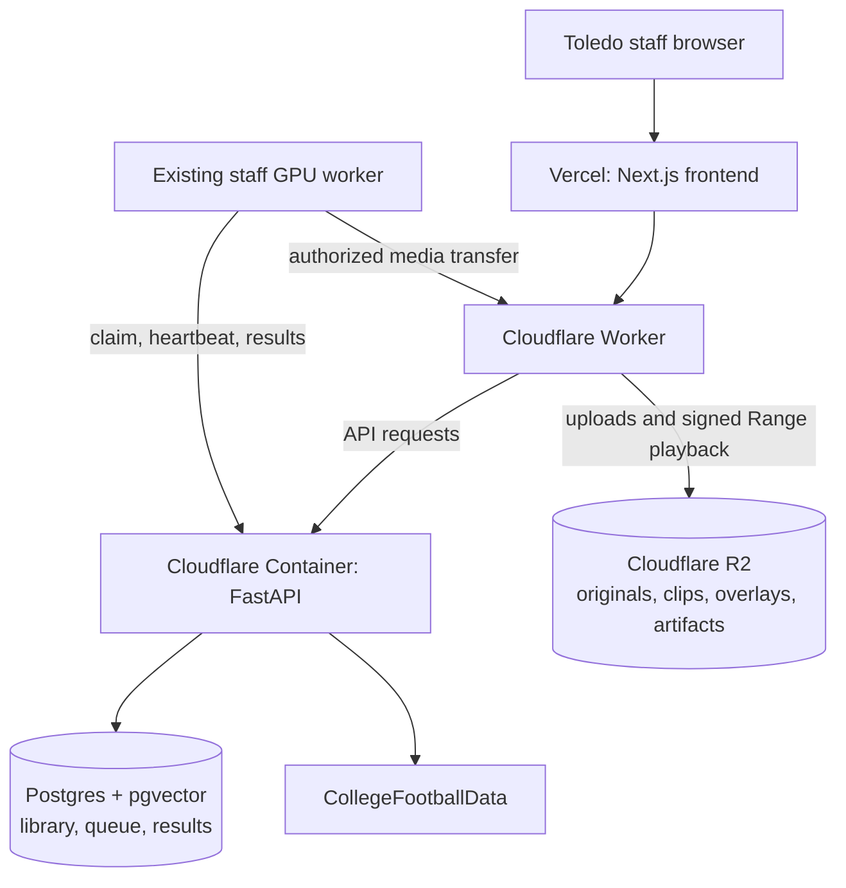

# Football-IQ: 20-Page Platform Overhaul Plan
### Toledo Football coaching staff and sports analytics department

## Page 1 of 20 — The outcome and the evidence

Football-IQ should become a dependable film and analysis workspace: upload film, receive correctly timed plays, follow players through the video, identify Toledo athletes where the evidence supports it, and investigate football questions through statistics linked directly to plays.

The overhaul must address the connected system—media processing, computer vision, identity, analytics, interface, and deployment. A navigation or styling update alone will not solve the problems found.

**Your confirmed requirements**

- Serve Toledo staff, including the sports analytics department.
- Keep the existing staff GPU as the production processor.
- Maximize unattended processing; uncertain fields remain unknown without requiring a coach review queue.
- Support practice, drone, sideline, end-zone, edited game, and television footage.
- Provide both short-segment practice feedback and detailed overnight analysis.
- Include position-specific statistics, pocket analysis, offensive-line gaps, and specialist models for distinct tasks.

**What this investigation established**

The repository was audited at commit `d1f4317bae5529864bd2d9df80713515dd5d9891`. Public official Hudl, SkillCorner, TruMedia, CFBD, and Toledo sources were researched. Selected local regression tests passed.

**What remains unverified**

The connected browser was unavailable, the Vercel connection required reauthentication, and the cloud environment did not provide production credentials. Consequently, this is a source-backed technical and product audit, not confirmation of the live Cloudflare configuration, deployed versions, or individual failing recordings.

The first implementation milestone must close those production evidence gaps. This plan contains twenty numbered page sections; printed pagination would require a subsequent document export.

---

## Page 2 of 20 — Why the current platform can behave this way

Several complaints have direct mechanisms in the current code.

| Problem | Verified implementation finding | Required correction |
|---|---|---|
| Game player labels missing | The normal worker path withholds the Toledo roster for game and unknown session types. | Establish team membership before resolving identity, then enable team-scoped game identification. |
| Duplicate numbers unresolved | Re-identification retains only globally unique roster numbers. | Preserve multiple candidates and resolve using team, unit, role, and temporal evidence. |
| Boxes or circles appear stuck | The renderer selects the nearest observation anywhere inside a track’s lifetime, including across long gaps. | Apply freshness limits and bounded interpolation; hide lost tracks. |
| Incorrect game cuts | Edited-game detection expects a narrow card-and-angle structure; other footage can fall back to optical flow. | Separate camera shots, football events, and logical plays. |
| Slow or drifting clips | Recent code addresses historical FPS and decoded-frame timing errors. Existing derivatives may still have older timing. | Verify deployed versions and artifact provenance, then regenerate affected derivatives. |
| Practice statistics absent | Team Stats is game-oriented; other aggregates exclude experimental pipeline metrics. | Unify analytics around eligibility and shared practice/game definitions. |
| Thin analytics | Some cards show the latest individual sample; some “expected” metric functions have no production caller. | Build cohort-based distributions and wire validated producers. |
| OL statistics misleading | Existing gap width measures player-center spacing, with weak role and direction handling. | Separate spacing, clear lane geometry, blocking interaction, and assignment evaluation. |

The most direct evidence is in [game roster handling](/workspace/UT-Football-IQ/gpu-worker/pipeline/backend.py:658), [overlay observation selection](/workspace/UT-Football-IQ/frontend/src/lib/tracking-time.ts:15), and [metric publication flags](/workspace/UT-Football-IQ/gpu-worker/pipeline/stage_metrics.py:284).

These findings identify mechanisms and risks. The exact cause of each production recording still requires an artifact-level trace.

---

## Page 3 of 20 — How the connected platform should operate

Retain the existing service boundaries:

The checked-in [Cloudflare configuration](/workspace/UT-Football-IQ/workers/api-edge/wrangler.jsonc:90) disables hosted processing. Keep that production default: the API container serves application requests, while the staff GPU processes film.

Postgres remains the durable queue. Preserve claim leases, heartbeats, fencing, checkpoints, and idempotent writes. Introducing another queue service is unnecessary for this release.

Hyperdrive is configured, but the FastAPI container’s supported database path uses its direct database connection. Do not assume that a bound Hyperdrive configuration proves the container uses it.

**Create one release inventory**

Record the deployed frontend, edge, backend, GPU worker, database schema, model weights, and artifact-generator versions. Vercel and Cloudflare deploy independently; updating either does not update the staff computer.

Verify build-time API origin, CORS, signed playback, R2 bindings, worker connectivity, and CFBD readiness without exposing secrets.

The success criterion is one traceable upload-to-result journey, with compatible component versions and identifiable artifacts—not a collection of green health endpoints.

---

## Page 4 of 20 — What to learn from Hudl and SkillCorner

These products provide useful references, but they are different product categories.

| Reference | Documented strength | Football-IQ application |
|---|---|---|
| Hudl football workflow | Film, breakdown tables, reports, playlists, and adjustable workspaces. | Keep video, labels, statistics, and cutups within one persistent task context. |
| Hudl IQ | Position analysis, line engagements, situational analysis, and statistics linked to video. | Organize analysis around coaching questions and contributing plays. |
| SkillCorner American football | Tracking, contextual metrics, expected outcomes, API delivery, and TruMedia integration. | Build trustworthy tracking and reusable analytical data before expanding predictions. |
| TruMedia | Filters, reports, comparisons, qualification thresholds, charts, and video-linked exploration. | Make cohorts, denominators, saved views, and drilldown consistent. |

Sources: [Hudl overview reports](https://support.hudl.com/s/article/overview-reports-new-hudl-fb?language=en_US), [SkillCorner American football](https://www.skillcorner.com/sports/american-football), and [TruMedia tools](https://football.help.trumedianetworks.com/football/trumedia-tools).

Hudl describes human intervention for field calibration, jersey identification, and track correction. That supports rigorous offline validation; it does not require Football-IQ to place every uncertain play into a mandatory coach queue. Your unattended workflow should publish qualified results and preserve unknowns. [Hudl’s data-creation process](https://www.hudl.com/blog/how-hudl-iq-creates-football-data)

**Potential Football-IQ advantages to develop**

- Toledo-specific terminology and roster context.
- One player-development history across practice and games.
- Immediate access to the evidence behind a measurement.
- Fast practice feedback using existing staff hardware.
- Optional corrections that survive reprocessing.

These are product opportunities. The available evidence does not establish that Football-IQ currently outperforms either competitor.

---

## Page 5 of 20 — A meaningful interface overhaul

Keep six primary destinations:

**Home · Film Room · Team Analytics · Players · Scouting · Reports**

Settings, processing diagnostics, and model evaluation remain utilities. Replace the separate “Model Insights” destination with an Analyst tools area inside Team Analytics.

**Make Film Room one persistent workspace**

- Left: searchable, filterable play table.
- Center: large video with angle selection and transport.
- Below video: play boundaries, snap, events, and measurement timeline.
- Right: collapsible player, label, or metric inspector.
- Processing status: available without leaving the film.

Selecting the next play should update this workspace, preserving filters and return context. Alternate camera angles belong to the same play.

Provide two saved layouts over the same data:

| Coach layout | Analyst layout |
|---|---|
| Large video, situation, relevant position metrics, cutups. | Detailed breakdown grid, evidence, distributions, uncertainty, versions, exports. |

Switching layouts must preserve the play, timestamp, and cohort.

**Visual direction**

Retain Toledo branding. Use a neutral film canvas, restrained gold emphasis, readable typography, consistent spacing, aligned numeric tables, and fewer nested cards. Reserve color for selection, team identity, and meaningful analytical differences.

Provide keyboard playback, next/previous play, frame stepping, visible focus, accessible controls, and tablet layouts.

The previous architecture change explicitly added no model outputs and retained separate clip review. The new acceptance standard must be task completion, not another route consolidation. [Previous architecture decision](/workspace/UT-Football-IQ/docs/adr/0003-coach-facing-information-architecture.md:30)

Target: reach a playable practice rep within three deliberate navigation actions after sign-in.

---

## Page 6 of 20 — Shared context, charts, and interfaces

Every analytical screen must operate on the same typed context:

- Season and date range.
- Session IDs and practice/game/drill type.
- Toledo or opponent library.
- Side of ball and position.
- Player, personnel, formation, and situation.
- Selected canonical play, camera view, and optional timestamp.

Encode active context in URLs. Persist named saved views server-side. Apply this precedence consistently: explicit URL values, saved-view defaults, then personal defaults.

“Next play,” chart drilldown, player profile navigation, angle switching, and Back must preserve applicable context. Keep existing deep links through compatibility adapters.

**Additive API changes**

| Interface | Purpose |
|---|---|
| `POST /api/v1/analytics/query` | Return cohort-based results, eligible denominator, exclusions, dataset version, and contributing-play reference. |
| `GET /api/v1/metrics/definitions` | Supply units, formulas, applicability, required evidence, and definition versions. |
| `GET /api/v1/plays/{id}/evidence` | Return time-bounded events, observations, views, and result provenance. |
| `/api/v1/saved-views` | Save and retrieve shared or personal analysis context and layout. |

Extend existing resources where equivalent functionality already exists; avoid parallel definitions.

Use Apache ECharts through one shared React adapter for statistical charts, and retain the field renderer for football geometry. Both must support linked selection and an accessible table representation.

Every chart must show its population, sample size, eligible count, unknown count, units, and definition. Selecting a mark opens its contributing plays. Aggregates must represent the selected cohort rather than the latest individual metric row.

---

## Page 7 of 20 — Correct playback before deeper analysis

Preserve original uploads as the media source of truth. Record checksum, stream timing, rational FPS, duration, dimensions, rotation, and audio availability.

Use presentation timestamps as the canonical clock. Analysis sampling must remain independent from playback speed.

**Playback requirements**

- Newly opened sessions start at 1×.
- Speed changes are explicit and visibly displayed.
- Clean playback is independent of rendered overlays.
- Signed-URL renewal preserves play, time, speed, and selection.
- Seeking, resizing, fullscreen, and angle changes preserve timing.
- Audio is preserved when present and supported.

The source already contains relevant repairs for fractional FPS and dropped decoded frames. Preserve those improvements. The remaining work includes proving they are deployed and preventing reuse of obsolete derivatives. [Timeline implementation](/workspace/UT-Football-IQ/gpu-worker/pipeline/video_timeline.py:35)

**Version derived media**

A reusable proxy must match source checksum, source window, timeline revision, encoder configuration, and artifact schema. Hash and source-window equality alone are insufficient.

Before publishing a derivative:

1. Compare its duration with the intended source interval.
2. Check source alignment at the beginning, middle, and end.
3. Validate audio synchronization where audio exists.
4. Reject invalid output and retain access to the original.

Regenerate affected proxies and overlays in a small canary batch before processing the wider library. Preserve play identities and staff corrections.

Proposed acceptance: a 20-second source interval plays within ±1% of normal elapsed time at 1×; derivative duration differs by no more than one output frame, with audio drift no greater than 100 ms.

---

## Page 8 of 20 — Play cutting across practice and game formats

Model three separate concepts:

| Concept | Meaning |
|---|---|
| Camera shot | A continuous visual view between cuts. |
| Football event sequence | Setup, snap, live action, and dead ball or other terminal event. |
| Canonical play | One football action, potentially represented by several shots or angles. |

A camera cut is evidence about video structure. It is not automatically a new play.

Replace the narrow edited-game path with format-aware orchestration:

- Continuous practice and coach film use formation/motion and temporal event evidence.
- Edited game film uses shot structure, cards, events, and angle relationships.
- Television footage additionally handles replays, graphics, crowd shots, commercials, and incomplete field coverage.
- Short extracts must work without requiring a minimum number of preceding cards.

Film type determines the appropriate segmentation strategy. Fast versus detailed processing determines the resource budget.

Store start, snap, end, confidence, source view, and result version. Default to three seconds before the snap and two seconds after live action, clamped to available footage.

Preserve penalties, aborted snaps, false starts, and no-play sequences with explicit labels. Their statistical eligibility differs from normal snaps.

Automatically propose angle and replay associations. Uncertain associations remain unresolved and cannot inflate snap counts.

Provide optional trim, split, merge, undo, and original-film context. Hudl’s documented clip and intercut workflows reinforce the importance of editable boundaries and angle alignment. [Playlists](https://support.hudl.com/s/article/create-playlists-new-hudl?language=en_US), [intercut editing](https://support.hudl.com/s/article/intercut-multiple-angles-hudl-classic?language=en_US&topic=Watch_and_Manage_Video_Classic).

---

## Page 9 of 20 — Real tracking and honest overlays

Tracking observations must include source timestamp, shot/view, track identity, bounding box, visibility state, confidence, and model/run version.

Improve association using motion, appearance, jersey evidence, and camera-motion compensation. The existing BoT-SORT adapter does not gain those capabilities merely by selecting its name; its required inputs must actually be wired and tested.

Evaluate the complete tracker against the current IoU baseline on Toledo footage. BoT-SORT provides a research baseline, not a transferable football accuracy guarantee. [BoT-SORT paper](https://arxiv.org/abs/2206.14651)

**Fix rendering independently of model training**

- Render against the presented video frame’s media timestamp.
- Interpolate only between observations of the same track and shot.
- Initially cap interpolation gaps at 200 ms.
- Allow no more than 100 ms of endpoint freshness.
- Hide the marker outside those limits or when the track is explicitly lost.
- Reset across shot cuts.
- Distinguish observed and interpolated positions in analyst inspection.

Replace detector-update-based track expiration with elapsed source time.

A tracked circle should follow the player’s ground-contact estimate. Perspective-aware field circles require valid calibration. Static drawings remain separate annotation objects with different labels and behavior.

**Required regression**

With observations only at zero and ten seconds, no tracked box or circle appears at five seconds.

Measure IDF1, HOTA, fragmentation, identity switches, visible-player recall, and localization. Average detector confidence must not be presented as evidence of identity continuity.

Footage with offscreen players must expose that coverage limitation instead of inventing complete trajectories.

---

## Page 10 of 20 — Roster, team, unit, and player identity

Retain the existing server-side CFBD integration. It already passes the requested roster season explicitly; an omitted-year bug was not established in this repository.

Use the 2026 football season for the initial “2026–27” roster. Do not manufacture a 2027 roster. Reconcile imported data against the [official Toledo 2026 roster](https://utrockets.com/sports/football/roster/2026) and retain CFBD athlete IDs. [CFBD roster reference](https://api.collegefootballdata.com/api/teams#get-roster)

**Correct the data model**

Represent jersey assignments with season, team, effective dates, and optional practice context. Permit duplicate numbers. Replace the active jersey-plus-position-group uniqueness rule that can blank valid roster numbers.

Preserve listed position separately from analytical position group and observed play role. RB, WR, and TE must remain separately analyzable.

**Resolve identity in stages**

1. Classify team or practice uniform group.
2. Establish field direction and side of ball where observable.
3. Accumulate readable jersey evidence across the track.
4. Rank roster candidates using team, unit, role, participation, and continuity.
5. Accept only qualified identities; retain unresolved candidates.

In practice, facing toward or away from the camera is a useful feature. It cannot be the sole offense/defense rule because camera location, direction changes, and player orientation vary.

In games, resolve Toledo versus opponent before attaching Toledo roster IDs. Remove the current game-roster restriction only after that safeguard is validated.

Uncertainty must not block film or supported anonymous team measurements. Optional staff corrections take precedence over subsequent model suggestions.

---

## Page 11 of 20 — Specialist models with shared evidence

Use specialist modules for distinct perception and football tasks, followed by deterministic calculations for statistics. A separate neural network for every number would duplicate errors and increase maintenance.

| Specialist | Primary output |
|---|---|
| Player and official detection | Boxes, body/foot estimates, classes. |
| Tracking and reacquisition | Timestamped trajectories and visibility. |
| Field calibration | Field coordinates, camera motion, geometric uncertainty. |
| Team/uniform classification | Team or practice-group membership. |
| Jersey recognition and identity | Number evidence and roster candidates. |
| Temporal play/event detection | Snap, boundaries, and terminal events. |
| Ball and possession | Ball observations, carrier, handoff, release, catch, kick. |
| Role assignment | QB, positional roles, eligible participation. |
| Blocking interactions | Engagements, matchups, chips, double teams, releases. |
| Routes, coverage, and pressure | Temporal football states and classifications. |
| Expected-outcome models | Separately evaluated predictions. |

Replace the current ordering knot with explicit dependencies. Uniform evidence can precede snap detection; unit and role evidence refine after snap and LOS estimation. Identity can update when stronger evidence arrives.

Use the existing model registry and stage adapters. Each module records weights checksum, training population, supported film, dependencies, evaluation, and runtime requirements.

For each task, compare the existing baseline with its specialist candidate. Promote the fastest candidate that passes every required quality slice on the staff GPU. If none passes, keep the capability experimental or unknown.

Reuse decoded frames and features. Schedule models within measured VRAM limits instead of keeping every specialist resident simultaneously.

---

## Page 12 of 20 — Trustworthy statistics and practice/game parity

Create one publication policy used by every endpoint, chart, export, and report.

A measurement becomes eligible when its model version is approved for that film category, required evidence exists, and per-play quality checks pass. Coaches do not need to approve every result.

Separate:

- Observed measurement.
- Model classification.
- Predicted outcome.
- Staff-entered coaching judgment.

Each value carries its definition version, units, canonical play, player/team where resolved, source timestamps, model/run lineage, eligibility, and exclusion reason.

**Fix counting**

- Team snaps: distinct canonical plays.
- Player reps: distinct player-play participation.
- Distance: one selected or fused trajectory per athlete-play.
- Alternate views and fragmented tracks cannot create extra reps.

Fast and detailed results are separate complete versions. Promote a qualified replacement atomically; do not mix incompatible outputs within one rep. Suppressed and superseded values must remain excluded everywhere.

**Practice and games share valid definitions**

Speed, route depth, separation, get-off, timing, and geometry can use common definitions. Comparisons must retain drill type, contact level, position, and situation.

Official results, down/distance, EPA, and score-dependent analysis require appropriate game context. Practice has team-, group-, and individual-period denominators rather than invented game outcomes.

Keep CFBD outcomes separate from video observations. Align play-by-play using clock, situation, sequence, and event evidence while handling missing plays and replays. Do not attach outcomes by sequential row position.

Replace the current disconnected experimental/validated flags with this explicit eligibility contract.

---

## Page 13 of 20 — Quarterback and pocket analysis

Present distinct measurements rather than one ambiguous “pocket seconds” average.

| Measurement | Operational definition |
|---|---|
| Time to throw | Forward-pass release timestamp minus snap timestamp. |
| Ball-holding duration | Snap until release, sack, or scramble initiation; preserve endpoint. |
| Time to first pressure | Snap until the first qualified pressure onset. |
| Tackle-box residence | Time before release, sack, or sustained exit from the snap-defined tackle corridor. |
| Dynamic pocket analysis | Validated protection-envelope geometry and compression through time. |

For the initial geometric residence measure, define corridor sides from the original tackles’ outer edges and the front from the LOS. Require an exit to persist for 200 ms. Label it **tackle-box residence**, with its definition visible. Do not silently equate it with every interpretation of pocket time.

Designed rollouts receive separate context. An exit does not automatically imply failed protection.

A throw before pressure ends the pressure-observation window. Truncated film produces incomplete observations. Use censor-aware analysis rather than averaging those cases as zero or complete durations.

**QB views**

- Synchronized snap/pressure/release/exit timeline.
- Time-to-throw distribution by concept and situation.
- Release-location field map.
- Dropback depth versus release-time scatterplot.
- Nearest-rusher distance curve.
- Pressure-free duration and pressure-to-sack outcomes.
- Passing outcome and receiver-context views.

Hudl documents passing analysis; SkillCorner documents tracking-informed completion expectation. Pocket residence is a Football-IQ specification requiring its own definition and validation. [Hudl QB tools](https://www.hudl.com/blog/how-to-evaluate-quarterbacks-using-hudl-iq), [SkillCorner CPOE](https://www.skillcorner.com/articles/cpoe-breaking-through-the-noise-in-qb-evaluation).

---

## Page 14 of 20 — Offensive line, gaps, and protection

Upgrade the existing OL stage rather than creating another disconnected feature. Its current role selection, exact-frame lookups, and center-spacing definition require correction. [Existing OL implementation](/workspace/UT-Football-IQ/gpu-worker/pipeline/stage_oline.py:198)

**Separate three gap concepts**

1. **Pre-snap split:** spacing between adjacent identified linemen at the snap.
2. **Geometric spacing:** their center-to-center separation through time.
3. **Clear lane width:** contiguous available space after accounting for body extents and defender occupancy at a specified cross-section.

Initial clear-lane analysis uses a transverse section at the LOS, with an explicitly displayed measurement region. It must not claim that a clear section proves a successful running path.

Name left/right A, B, C, and edge gaps relative to the initial formation and attacking direction. Pulling or crossing linemen do not rename the original gaps. Intended gap requires play-call evidence; actual entry gap comes from the runner’s path.

**OL measurements**

- Splits, pass-set depth, and first-second displacement.
- Pocket width, depth, and compression.
- Gap opening/closure time and width at handoff or entry.
- Engagement start/end and duration.
- Single/double-team and chip exposure.
- Combo release and pull timing.
- Penetration conceded and pressure by matchup.
- Stunt exchange and block-shed events.

Use trench replays, gap-by-time heatmaps, five-lineman small multiples, and blocker–rusher matrices.

Hudl explicitly documents engagement duration, time to pressure, and run-gap outcomes. Dynamic lane and protection analysis should extend those ideas with film-linked geometry. [Hudl OL tools](https://www.hudl.com/blog/how-to-evaluate-offensive-linemen-using-hudl-iq).

---

## Page 15 of 20 — Running backs, receivers, and tight ends

Provide dedicated position tabs rather than grouping every skill player into one generic dashboard.

| Position | Initial qualified measurements | Interaction-dependent expansion |
|---|---|---|
| RB | Alignment, handoff-to-LOS time, actual entry gap, path length, cut location, speed and acceleration. | First contact, yards before/after contact, missed tackle events, lane timing, pass protection. |
| WR | Split/alignment, release movement, route depth, break location, speed, observed separation through time. | Route classification, press-release outcome, target/catch events, contested targets, YAC. |
| TE | Inline/slot/backfield alignment, route depth, separation, movement profile. | Block/chip/route participation, chip-to-route delay, engagement and release. |

Define forward yards using attacking direction and the LOS. Preserve negative gains. Distinguish path length from net advance.

Receiver separation must specify the comparison: nearest defender, identified coverage defender, or another defined relationship. Nearest-defender distance alone does not establish responsibility.

**Views**

- RB run-path density and gap usage.
- Contact-marked rushing trajectories.
- WR route atlas and route-depth distributions.
- Separation curves aligned to snap, release, and catch.
- Route-by-coverage matrices when coverage is qualified.
- TE usage transitions and chip-delay distributions.
- Player trends separated by practice drill and game context.

Normalize by eligible opportunities: rushes, routes, targets, pass-protection reps, or blocking reps. Total snaps are not the correct denominator for every statistic.

Documented references include [Hudl RB analysis](https://www.hudl.com/blog/how-to-evaluate-running-backs-using-hudl-iq), [receiver analysis](https://www.hudl.com/blog/how-to-evaluate-wide-receivers-using-hudl-iq), and [contextual physical metrics](https://www.hudl.com/blog/hudl-iq-our-new-contextualized-physical-metrics).

---

## Page 16 of 20 — Defense and special teams

Organize defensive analysis around alignment, movement, interaction, and outcome.

| Unit | Initial qualified measurements | Later qualified classifications |
|---|---|---|
| DL/EDGE | Alignment, technique, first movement, penetration, rush path, QB distance. | Engagement, shed time, pressure onset/duration, double teams, stunts, matchup outcomes. |
| LB | Alignment/depth, first movement, pursuit path, mesh depth, coverage depth. | Blitz participation, fit arrival, block shedding, tackle approach and coverage responsibility. |
| DB | Cushion, depth, transition movement, separation, closing speed, paired trajectories. | Target responsibility, coverage exchange, leverage execution, tackle and pass outcomes. |
| Special teams | Unit participation and observable snap/kick/punt events. | Operation time, hang time, landing point, coverage arrival, return path, blocks and tackles. |

A distance threshold can produce a **rusher-proximity measurement**. Football pressure requires separately validated contextual classification. Early pressure must remain recorded even if it disappears before the throw.

First movement is observable; recognition and assignment correctness require additional evidence. Keep those names distinct.

**Views**

- Rush-path atlas and pressure timing.
- Technique-by-situation matrix.
- Pursuit fans and approach paths.
- Paired receiver–defender replay.
- Cushion and separation timelines.
- Kick/punt landing maps and coverage fronts.

Use position-specific eligible populations: pass-rush opportunities, coverage snaps, tackle opportunities, kickoffs, punts, or returns.

Official product references support alignment, engagement, disruption, separation, and tackling analysis: [Hudl DL](https://www.hudl.com/blog/how-to-evaluate-defensive-linemen-using-hudl-iq), [LB](https://www.hudl.com/blog/how-to-evaluate-linebackers-using-hudl-iq), and [DB tools](https://www.hudl.com/blog/how-to-evaluate-defensive-backs-using-hudl-iq).

---

## Page 17 of 20 — Deeper analytics and data-science views

Build analytical depth through definitions, comparisons, uncertainty, and film evidence.

| Coaching or research question | Appropriate view |
|---|---|
| How consistent is release timing? | Distribution and event-aligned player comparisons. |
| When does protection break down? | Pressure timelines, censor-aware curves, matchup splits. |
| Which gaps open and close? | Gap-by-time heatmap and synchronized trench geometry. |
| Where do receivers separate? | Route atlas and separation curves by concept/coverage. |
| Which defenders arrive effectively? | Pursuit paths, closing-speed distributions, outcome splits. |
| Is practice development transferring? | Player trends stratified by drill, opponent, and role. |
| Is the model dependable? | Coverage, error distributions, confusion matrices, calibration. |

Include percentile bands, confidence intervals where justified, minimum-sample indicators, and qualification filters. Avoid treating many frames from one play as independent observations.

Separate descriptive association from causal claims. A failed play does not establish an individual assignment error.

**Correct existing metric names**

Observed separation should be named observed separation. Observed post-catch movement must not be labeled expected yards. Motion features should not be presented as vision, decision quality, broken tackles, or blocking success without the required evidence.

**Predictive layer**

Develop completion probability, expected rushing/YAC, and contextual pressure models after the observed data is dependable. Evaluate against simple baselines using held-out games or sessions, calibration, Brier/log loss, and relevant outcome error.

Train/test splits must prevent neighboring footage or alternate views of the same play leaking between sets.

SkillCorner’s expected-outcome offering provides direction; Football-IQ predictions require independent validation on the actual available population. [SkillCorner American football](https://www.skillcorner.com/sports/american-football).

---

## Page 18 of 20 — Unattended processing on the staff GPU

Provide two service levels over the same durable processing system.

| Service level | Intended result | Proposed performance target |
|---|---|---|
| Fast feedback | Playable film, first-pass cuts/tracks, qualified basic observations. | A segment of up to five minutes at 1080p completes within ten minutes after upload, at the 95th percentile. |
| Detailed analysis | Improved tracking/identity and qualified specialist outputs. | Ninety source-video minutes complete within eight hours on the benchmarked production GPU. |

These are acceptance targets, not established hardware performance. Count source-video minutes across cameras. Benchmark the actual GPU, VRAM, decode, storage, network, and thermal behavior.

Keep existing thermal protection, checkpointing, and safe recovery. Start with one inference job at a time; detailed work yields at safe checkpoints when fast work arrives.

**Make upload intent durable**

The existing auto-enqueue path can leave uploaded film without a job when saturated. Persist processing intent even when execution capacity is unavailable. Retry scheduling automatically with idempotency and bounded backoff.

A disconnected GPU leaves work queued with a readable status. Closing the browser does not cancel processing.

Expose separate readiness states: film, cuts, tracking, identity coverage, and analytics coverage. One failed specialist must not conceal usable film.

Preserve fast results while detailed processing runs. Promote replacements atomically only after eligibility checks.

Use measured completion estimates rather than “CPU” or model names in coach controls. Keep hardware, model, and diagnostic detail available to analysts and administrators.

---

## Page 19 of 20 — Validation that proves the overhaul works

Create a held-out benchmark of at least 240 plays from twelve independent sources, balanced across practice, coach game film, and television footage.

Annotate boundaries for all plays, dense tracks for 48 balanced plays, and identities wherever knowable. Double-label 20% and adjudicate disagreements. Hold out entire sessions/games and their alternate views.

Offline football annotation is required for evaluation; it does not create a mandatory production review queue.

**Proposed release gates**

| Area | Gate |
|---|---|
| Segmentation | ≥95% precision and recall per film category; ≥99% retain complete live action. |
| Event timing | Snap/release median absolute error ≤0.10 s and 95th percentile ≤0.25 s on supported footage. |
| Tracking | Target IDF1 ≥90 and HOTA ≥70; report visibility coverage, switches, and fragmentation per slice. |
| Auto identity | ≥99.5% precision, with 95% confidence lower bound ≥99%; ≥90% coverage on readable, team-resolved cases. |
| Spatial measurements | Median location error ≤0.35 yd; 95th percentile ≤0.75 yd. |
| Clear lane width | Separate 90th-percentile width error ≤0.30 yd; otherwise publish spacing only. |
| Interaction events | ≥95% accepted precision, with recall, coverage, and onset error reported. |
| Aggregation | Additional views, fragments, and reprocessing never inflate counts. |

Collect enough accepted identity cases to support the confidence bound; target at least 2,000.

Regression scenarios must include long tracking gaps, mirrored views, duplicate jerseys, same-number opponents, replays, missing cards, fractional/VFR timing, late-game seeks, rollouts, early pressure, occlusion, queue saturation, GPU interruption, and correction preservation.

The audit’s 67 selected worker tests and 20 frontend tests passed. They establish regression behavior, not real-film accuracy.

---

## Page 20 of 20 — Delivery sequence and completion criteria

Implement in gated packages, with a working release after each package.

| Package | Deliverables | Completion gate |
|---|---|---|
| **P0: Establish production truth** | Release inventory; trace failing recordings; GPU/model inventory; baseline benchmark; durable processing intent. | Every reported failure is tied to a reproducible source/artifact/version or explicitly unresolved evidence gap. |
| **P1: Dependable film** | Timing validation, derivative invalidation, format-aware cuts, bounded overlays, recovery. | All film categories pass media and segmentation gates; stuck-marker regression passes. |
| **P2: Identity and usable workspace** | Early team evidence, duplicate-aware roster assignments, qualified identity, persistent Film Room, shared filters. | Identity precision/coverage gates and daily coaching task tests pass. |
| **P3: Observed position analytics** | Unified publication policy, practice/game parity, canonical counts, QB timing, routes, separation, OL spacing, movement metrics. | Chart denominators reconcile with plays; every published value opens its evidence. |
| **P4: Interaction analytics** | Blocking, clear lanes, pocket geometry, pressure, contact, coverage responsibilities. | Each specialist passes its own annotation-based gate before automatic publication. |
| **P5: Predictive analytics** | Expected outcomes and comparative models. | Held-out performance and calibration beat documented baselines. |

Assign frontend/backend ownership, CV/ML ownership, and a Toledo football analyst responsible for definitions and annotation. Package estimates follow the measured baseline and actual staffing rather than assumed model readiness.

Use additive migrations, preserve originals and corrections, and canary reprocessing before wider backfills. Retain the current and two previous known-good deployable images, subject to registry capacity; do not delete the only usable rollback.

**Final acceptance:** Toledo staff can upload without babysitting, watch normal-speed plays, follow valid tracks, obtain qualified player labels, compare practice and games, and investigate position-specific questions through statistics tied to film. Unknowns and processing coverage remain visible. Production verification must demonstrate that complete workflow before the overhaul is declared finished.
